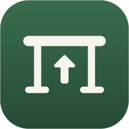
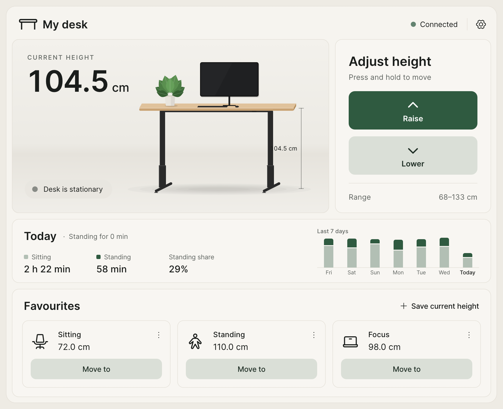
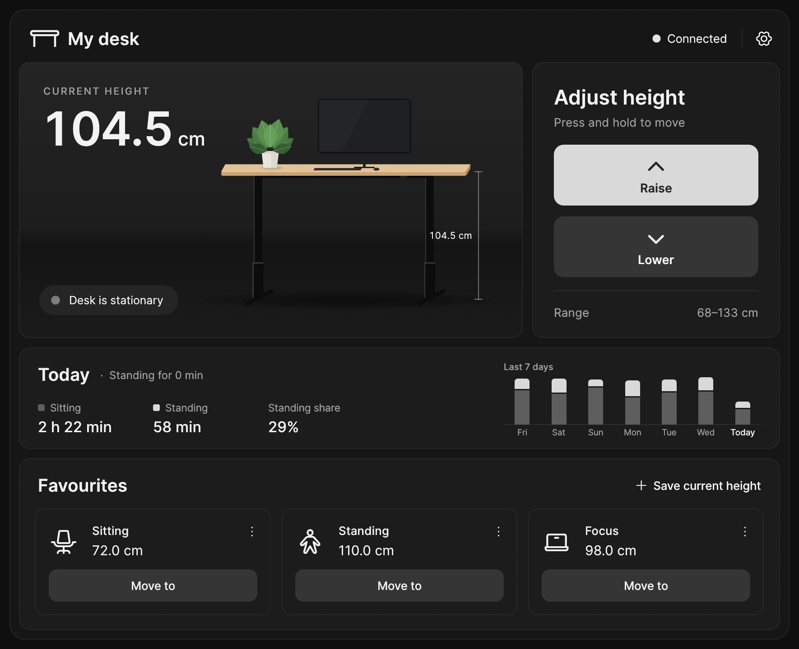
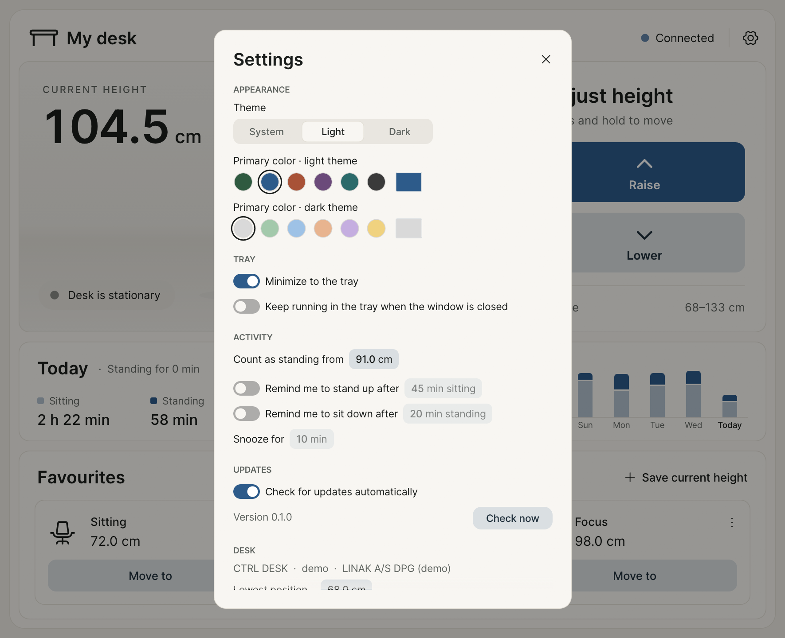
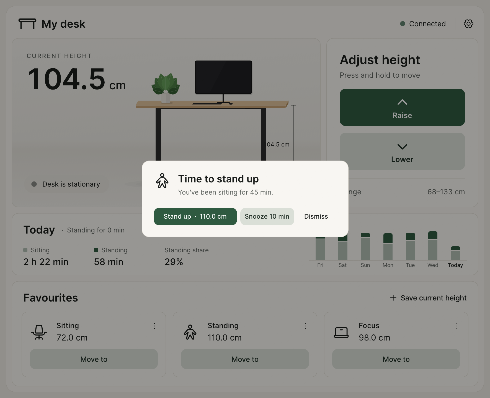
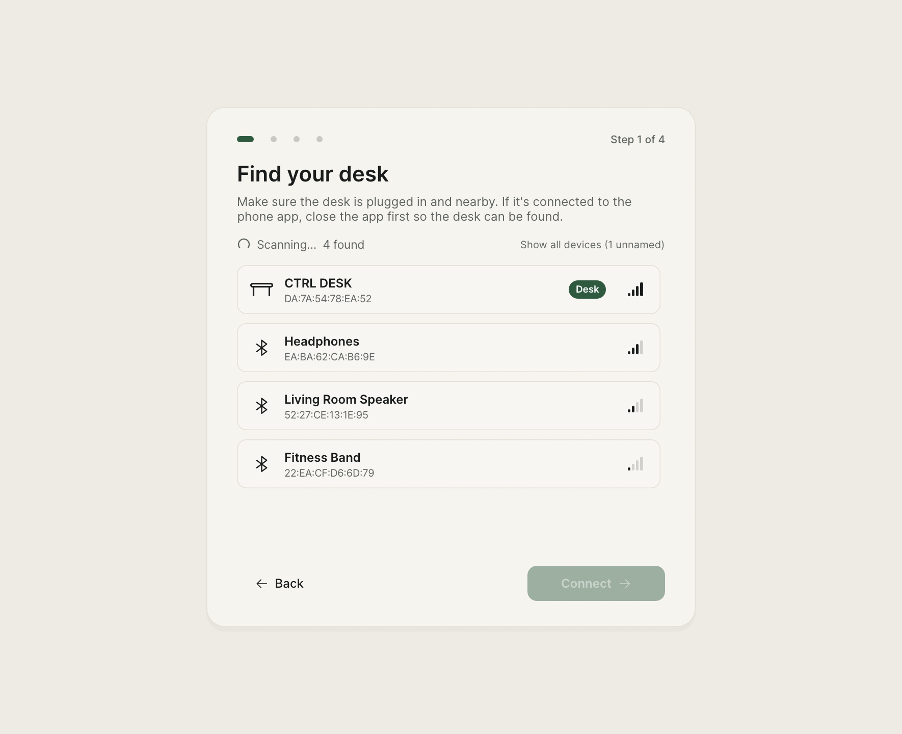
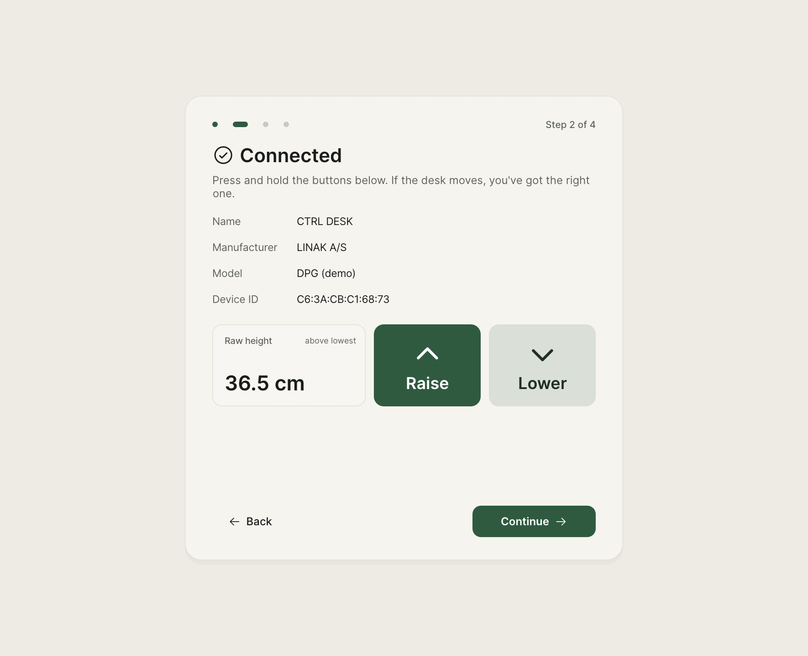
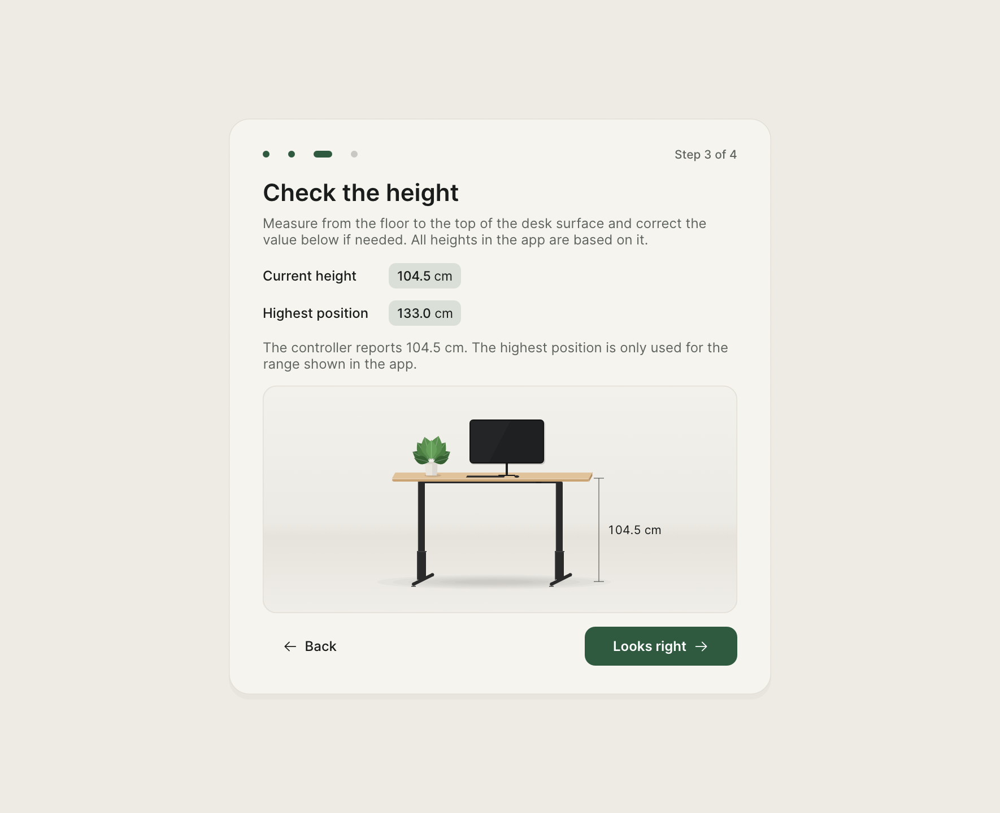
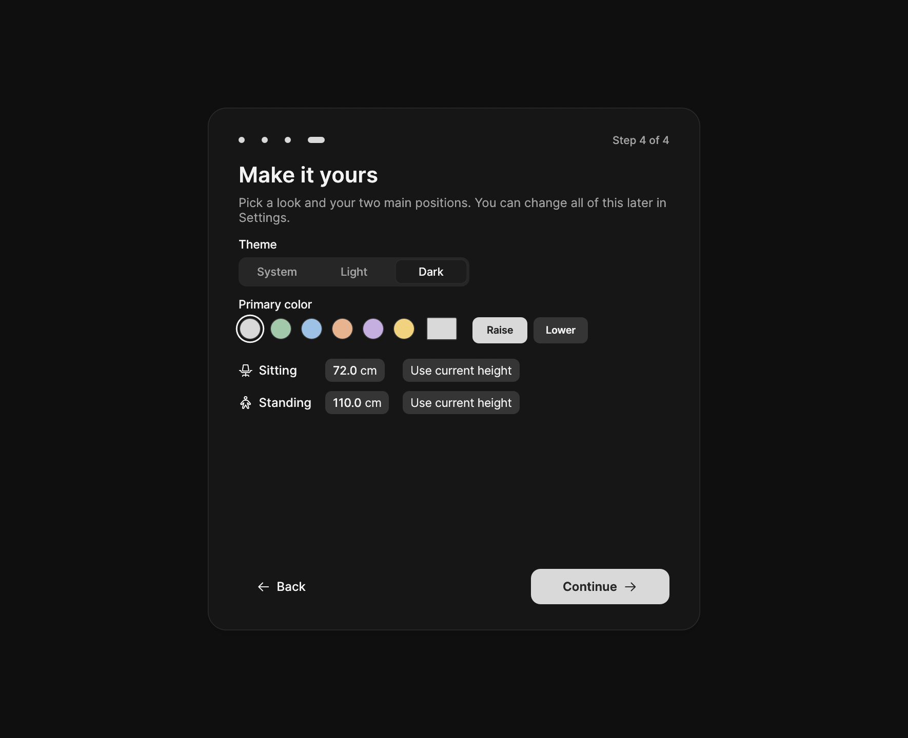

# CTRL Desk

A desktop app and Rust library for Linak DPG standing desks over Bluetooth LE.
This covers Linak-based white-label desks such as "CTRL DESK", and probably the
IKEA IDÅSEN too.



| Dark theme | Settings with a custom primary color | Reminder to stand up |
| --- | --- | --- |
|  |  |  |

## Features

- **Live height.** The tabletop in the illustration follows the real desk.
- **Press and hold** Raise / Lower, or hold the ↑ / ↓ keys.
- **Favourites.** Move to a saved height with one click, and save, rename,
  re-icon or delete positions.
- **Onboarding.** Find the desk, confirm it's the right one, calibrate the
  height and pick your favourite positions.
- **Light, dark and system themes**, with a separately configurable primary
  color for each.
- **Automatic reconnect** when the desk goes out of range or is power-cycled.
- **Sitting and standing time.** The **Today** card shows how long you've sat
  and stood today, how long you've been in your current position, and a chart
  of the last 7 days. Heights from the **Count as standing from** setting up
  count as standing. By default that's halfway between your Sitting and
  Standing favourites. Time only counts while the desk is connected and not
  moving.
- **Reminders to change position** (optional). After sitting for a set time
  (45 min by default), CTRL Desk brings its window to the front and offers to
  move the desk to your standing height. Reminders to sit down again after
  standing work the same way. You can snooze or dismiss them. Turn them on
  under **Settings → Activity**.
- **Update check.** CTRL Desk checks GitHub for a new release on start and once
  a day; turn this off under **Settings → Updates**. When CTRL Desk was installed
  with the MSI installer, **Update to …** downloads and installs the new
  version, then restarts the app. Otherwise it opens the release page.
- **System tray.** Minimize to the tray, then show or hide the window with a
  click. The tray menu shows the live height and has your favourites, Stop
  and Quit. The tray glyph follows the taskbar's light or dark theme.
- **Demo mode** with a simulated desk, for trying the app without hardware.

### Onboarding

| Find your desk | Confirm it | Check the height | Make it yours |
| --- | --- | --- | --- |
|  |  |  |  |

## Install

Download the package for your platform from the **Releases** page:

| Platform | Package | Notes |
| --- | --- | --- |
| Windows 10/11 (x64) | `desk-ctrl-<version>-x86_64-pc-windows-msvc.msi` | Recommended. Installs for the current user (no administrator rights needed), adds a Start menu entry and supports in-app updates. Uninstall under *Settings → Apps*. |
| Windows 10/11 (x64), portable | `desk-ctrl-<version>-x86_64-pc-windows-msvc.zip` | Unzip and run `desk-ctrl.exe`. |
| macOS 11+ (Apple Silicon / Intel) | `desk-ctrl-<version>-<arch>-apple-darwin.zip` | Contains `CTRL Desk.app`. The app is not notarized: the first time, right-click it and choose **Open**. Allow Bluetooth access when asked. |
| Linux (x64) | `desk-ctrl-<version>-x86_64-unknown-linux-gnu.tar.gz` | Needs BlueZ running (`bluetoothd`). Your user must be allowed to use Bluetooth over D-Bus (the default on most desktop distributions). Includes a `.desktop` file and icon. The tray uses StatusNotifierItem: KDE supports it out of the box, GNOME needs the AppIndicator extension. |

Try it without a desk:

```bash
desk-ctrl --demo
```

Demo mode keeps its settings separate from the real configuration.

### Troubleshooting

- **The desk doesn't show up.** Only one device can be connected to the desk
  at a time. Close the Linak/IKEA phone app or disconnect your phone first.
- **It connects, but nothing moves.** Press a button on the desk's control
  panel once to wake it, then try again.
- **Windows: the desk is "paired" in Bluetooth settings.** Pairing isn't
  needed. If connecting fails, remove the desk under *Settings → Bluetooth &
  devices* and let the app connect directly.

By default, minimizing hides the window in the tray, and closing the window
quits. Both can be changed under **Settings → Tray**. Use **Quit** in the tray
menu to exit while "keep running in the tray" is on.

Settings are stored in `config.json`, and the sitting/standing history in
`activity.json`, in the platform config directory:
`%APPDATA%\desk-ctrl` on Windows, `~/Library/Application Support/desk-ctrl` on
macOS, and `~/.config/desk-ctrl` on Linux.

## Build from source

You need Rust (stable). On Linux, also install the Bluetooth and windowing
development packages, for example on Debian/Ubuntu:

```bash
sudo apt-get install pkg-config libdbus-1-dev libxkbcommon-dev libwayland-dev libx11-dev libxcursor-dev libxrandr-dev libxi-dev libgl1-mesa-dev
```

Then run:

```bash
cargo run --release -p desk_app
```

The repository is a Cargo workspace:

| Path | Contents |
| --- | --- |
| [`src/`](src) | `linak_desk`, the library: protocol encoding (unit tested) and an async `Desk` API built on [btleplug](https://github.com/deviceplug/btleplug). |
| [`app/`](app) | `desk_app`, the egui desktop client (binary `desk-ctrl`). |
| [`examples/`](examples) | `deskctl`, a small command-line tool, and `probe`, a read-only GATT dump for identifying desks. |
| [`scripts/`](scripts) | Screenshot generation and release packaging. |

### Library

```rust
use std::time::Duration;
use linak_desk::{Desk, MoveOptions};

let adapter = Desk::default_adapter().await?;
let peripheral = Desk::find_by_name(&adapter, "CTRL DESK", Duration::from_secs(10)).await?;
let desk = Desk::connect(peripheral, None).await?;
println!("height: {:.1} mm", desk.height_mm().await?);
desk.move_to_mm(1000.0, &MoveOptions::default()).await?;
```

To remember a desk, store `linak_desk::device_id(&peripheral)` and look it up
again with `Desk::find_by_id`. That ID is the MAC address on Windows and Linux.
macOS doesn't expose MAC addresses, so there it is a CoreBluetooth UUID.

### Command line

```bash
cargo run --example deskctl -- info
cargo run --example deskctl -- move-to 1050
cargo run --example deskctl -- --name "CTRL DESK" watch
```

## Screenshots

The images above are generated from demo mode, so they need no hardware and
contain no real device identifiers (demo device IDs are random on every run):

```bash
scripts/screenshots.sh                     # writes docs/screenshots/*.png
xvfb-run -a scripts/screenshots.sh         # on a headless Linux machine
```

CI regenerates them on every push and uploads them as the `screenshots`
artifact.

The app has a few environment variables for development and automation:

| Variable | Effect |
| --- | --- |
| `DESK_CTRL_DEMO=1` | Same as `--demo`. |
| `DESK_CTRL_CONFIG=<file>` | Use this config file. |
| `DESK_CTRL_SCREENSHOT=<file.png>` | Save a screenshot after `DESK_CTRL_SCREENSHOT_DELAY` seconds (default 3), then exit. |
| `DESK_CTRL_STEP=find\|connect\|calibrate\|personalise\|done` | Advance onboarding to that step automatically. |
| `DESK_CTRL_SELECT=<id or name>` | The device to pick on the Find step. |
| `DESK_CTRL_SETTINGS=1` | Open Settings on start. |
| `DESK_CTRL_EXPORT_ICONS=<dir>` | Write the app icon (16–1024 px), both tray glyphs as PNGs and `icon.ico`, then exit. |
| `DESK_CTRL_MOVE_TO=<mm>` | Move the desk to this height once connected (handy for capturing motion). |
| `DESK_CTRL_REMINDER=stand\|sit` | Show the reminder to stand up or sit down on start. |

## Releases

CI ([`.github/workflows/ci.yml`](.github/workflows/ci.yml)) runs the following
on every push and pull request:
- `rustfmt` and `clippy` checks
- tests and release builds on Linux, Windows and macOS
- the screenshot run on Linux

To publish a release, set `version` in [`app/Cargo.toml`](app/Cargo.toml)
(the in-app update check compares against it), commit, and push a matching tag:

```bash
git tag v0.2.0
git push origin v0.2.0
```

[`.github/workflows/release.yml`](.github/workflows/release.yml) checks that the
tag matches the app version, then runs CI. It builds and packages Windows (zip
and MSI), Linux and macOS (Apple Silicon and Intel), and attaches the packages
to a GitHub release.

The MSI is built with the [WiX Toolset](https://wixtoolset.org) v5 from
[`app/wix/main.wxs`](app/wix/main.wxs). To build it locally, install WiX with
`dotnet tool install --global wix --version 5.0.2`, then run
`scripts/package.sh x86_64-pc-windows-msvc <version>`. Keep the `UpgradeCode`
and component GUIDs unchanged, so new versions upgrade old installs in place.

## Credits

The protocol details come from
[rhyst/linak-controller](https://github.com/rhyst/linak-controller) (MIT),
which is included as a submodule for reference. The bundled
[Inter](https://github.com/rsms/inter) font is licensed under the SIL Open Font
License 1.1 ([`app/assets/fonts/OFL.txt`](app/assets/fonts/OFL.txt)). Icons come
from [Phosphor](https://phosphoricons.com) via `egui-phosphor`. The app icon is
drawn in code ([`app/src/icon.rs`](app/src/icon.rs)) and embedded into the
Windows executable at build time.
